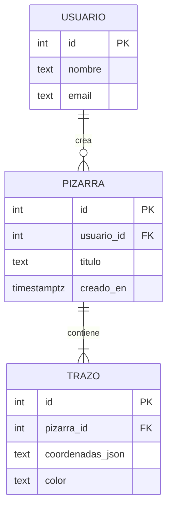

# PRD · <Nombre de tu producto>

> Documento de requisitos del producto (Product Requirements Document).
> Complétalo en el Sprint 0 (historia H0.3) y pide la aprobación del profesor en un Issue.
> Cada requisito funcional (RF) se convierte en un Issue con la plantilla "Historia de usuario".

| Campo | Valor |
| --- | --- |
| Alumno |libia berrios. C.I:27.545.345 |
| Proyecto n.º | 27|
| Sitio de referencia | Excalidraw |
| Compañero revisor | |
| URL desplegada | (se completa en el Sprint 5) |

## 1. Problema

Falta de herramientas de dibujo colaborativas, ligeras y accesibles en la web que permitan a estudiantes y equipos de trabajo plasmar ideas visuales, esquemas y diagramas rápidamente desde cualquier dispositivo sin fricciones ni configuraciones complejas.

## 2. Usuarios

- **Usuario principal:** Estudiantes, niños , desarrolladores que necesitan realizar bocetos rápidos de arquitecturas de software, flujos o notas visuales desde laptops o PCs de escritorio.
- **Usuario secundario:**Equipos de trabajo para lluvias de ideas visuales.

## 3. Objetivo y métrica de éxito

«Un usuario dibuja y guarda un trazo en el lienzo en menos de 15 segundos.».

## 4. Alcance del MVP

1. Lienzo interactivo web para trazos libres con selección de color y grosor.
2. Guardado de pizarras y proyectos en la base de datos relacional.
3. Herramienta de borrador y limpieza del lienzo.
4. Exportación del dibujo a imagen (PNG/JPEG).
5. Control de versiones con Git y Pull Requests.
6. Autenticación básica de usuarios.

### Funcionalidades → carpetas de `src/` (screaming architecture)

Cada funcionalidad del alcance será una carpeta en `src/`. Nómbralas en inglés y en plural.

| Funcionalidad | Carpeta |
| --- | --- |
| pizarras | `src/boards` |
| trazos / dibujos | `src/drawings` |
| usuarios | `src/users` |

## 5. Fuera de alcance
- Salas de chat de voz o videollamada.
- Sincronización multiusuario simultánea en tiempo real con WebSockets complejos.

## 6. Requisitos funcionales

| ID | Requisito | Prioridad (alta, media, baja) |
| --- | --- | --- |
| RF-01 | Crear, editar y guardar nuevas pizarras de dibujo. | Alta |
| RF-02 | Registrar trazos fluidos con diferentes grosores. | Alta |
| RF-03 | Exportar el lienzo activo como imagen descargable. | Media |

## 7. Requisitos no funcionales

- Responsive, móvil primero (375 px y 1280 px).
- Lighthouse ≥ 90 en Accesibilidad y Buenas prácticas.
- 0 errores en la consola del navegador.
- Funciona con 10.000 registros sin congelarse.

## 8. Modelo de datos

Diagrama entidad-relación y tablas PostgreSQL con tipos, claves y restricciones.
GitHub dibuja diagramas Mermaid; edita este ejemplo:

## 9. Reto técnico distintivo

## 9. Reto técnico distintivo

El reto técnico seleccionado es la **Pila de deshacer y rehacer (Undo-Redo) combinada con la exportación a PNG**, implementando una estructura lineal propia de pila en `src/shared/structures/` para administrar el historial de trazos en memoria de forma eficiente antes de vaciarlo al lienzo o exportarlo como imagen final.

## 10. Riesgos y preguntas abiertas

-Asegurar el rendimiento óptimo del renderizado en canvas al acumular una gran cantidad de trazos complejos.
